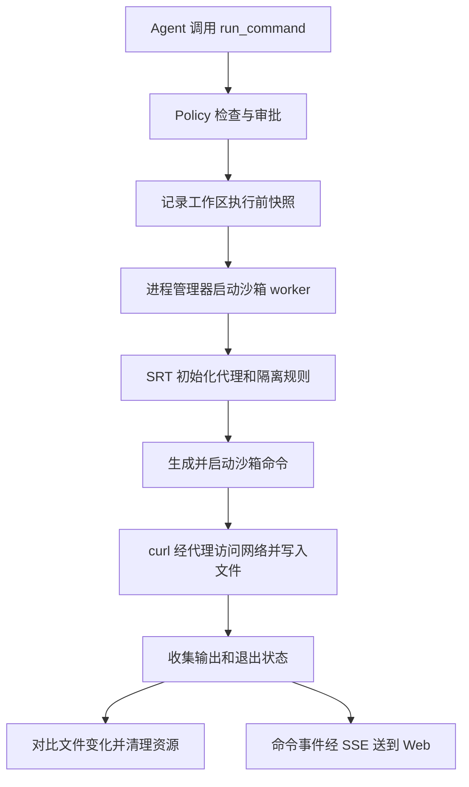

# PI Harness Shell 工具与沙箱执行机制

让 Agent 执行一条 Shell 命令，乍看只需要调用一次 `spawn`。但命令可能运行很久，可能修改文件，也可能在安装依赖时联网。用户关掉页面以后，进程怎么办？命令输出到哪儿去？Agent 看到“已启动”以后，怎么知道测试最后有没有通过？

PI Harness 把这些问题交给了工具层、审批策略、沙箱和进程管理器共同处理。本文结合项目当前源码梳理这条链路，再对比其他 Agent 常见的沙箱方案。项目锁定的 `@anthropic-ai/sandbox-runtime` 版本为 `0.0.75`，具体实现可能随版本变化。

## 从三个工具开始

项目向 Agent 提供 `run_command`、`wait_command` 和 `stop_command`。第一个负责启动命令，第二个等待并查看受监管命令的状态，第三个停止命令。它们注册在 [workspace-tool-registry.ts](../packages/tools/src/workspace-tool-registry.ts) 中。

`run_command` 的工作目录固定为当前 Session 绑定的 workspace 根目录，模型不能通过参数随意改成其他目录。工具的参数由 TypeBox 描述和校验。`command` 是命令文本，`timeoutMs` 控制进程总生存时间，`yieldTimeMs` 控制本次工具调用等待多久。前者默认四小时、最长二十四小时；后者默认十秒，允许设置为 250 毫秒到 30 秒。

工具还有一个可选的 `prefixRule`。模型可以为合适的安全命令建议一个有序 argv 前缀，供用户在人工审批时选择允许类似命令。这个字段本身不授予权限，Policy 仍会检查前缀和 Shell 语法。命令定义可以从 [run-command.ts](../packages/tools/src/tools/run-command.ts) 看起。

`run_command` 和 `stop_command` 标记为串行执行，`wait_command` 标记为可并行。能否与其他工作同时进行，还取决于 Agent 发起的工具调用批次和调度方式。

## 一条命令从哪里走到哪里

假设 Agent 在 Linux 工作区运行下面的命令，用网络响应生成一个文件。

```bash
curl -sS https://example.com -o result.html
```

下面的流程假设当前是 `request_approval` 模式，沙箱 profile 为 `workspace_write`，网络允许列表为空且没有拒绝规则。示例用于解释流程，不代表已经实际运行过这条命令。



命令首先经过 Runtime 的工具钩子和 Policy。`request_approval` 模式下，普通 Shell 调用通常需要用户批准。`auto_approve` 模式会让独立审批模型复核，只有模型明确允许才自动执行，模型失败、不确定或超时则回退人工审批。`full_access` 模式自动批准 Shell，并直接在宿主机运行，仍保留固定工作目录、环境变量筛选、超时和进程监管。

用户批准后，`run_command` 尝试记录执行前的工作区文本文件快照。命令结束时，项目用它对比文件变化，生成文件变更信息。快照或对比失败时，统计可能不完整，但它不承担回滚职责。

接着 `CommandProcessManager` 创建命令 ID，选择宿主机或沙箱执行路径。本例进入沙箱路径。worker 完成 SRT 初始化并启动 Shell，Shell 再运行 `curl`。网络请求经沙箱代理处理，允许后响应写入 workspace 中的 `result.html`。命令退出后，管理器收集退出状态、统计文件变化，最后返回工具结果或进入长命令监管流程。

## 审批和沙箱分别管什么

审批决定命令是否可以启动。沙箱在命令运行期间限制进程能访问的资源。普通审批模式下，命令获批以后仍然在沙箱中运行。

项目使用 Anthropic 的 [Sandbox Runtime](https://github.com/anthropics/sandbox-runtime)，简称 SRT。它借助操作系统机制限制进程及其子进程的文件和网络访问。SRT 的 README 将其定位为无需容器即可施加操作系统级限制的运行时。项目的配置与启动封装位于 [process-sandbox.ts](../packages/sandbox/src/process-sandbox.ts)。

每次沙箱调用会解析 workspace 的真实路径，并创建独立临时目录。项目配置允许读取 workspace、临时目录、Node 运行目录和部分已加载 Skill 目录；真实用户主目录、workspace 上级区域和 daemon 受保护目录纳入读取限制。写入权限由 profile 决定，`read_only` 不允许写 workspace，`workspace_write` 允许写 workspace。SRT 还会加入自身默认可写路径，受保护目录保持显式限制。

worker 的环境变量也经过筛选。项目只传入 `PATH`、语言和终端类型等少量变量，`HOME`、`TMPDIR` 等指向本次临时目录。这样命令默认不会把真实用户主目录当作自己的配置目录。凭据注入和屏蔽有单独处理，不能理解成把 daemon 的全部环境交给命令。

网络策略包含 `allowedDomains` 和 `deniedDomains`，拒绝规则优先。项目默认允许列表为空，这时未命中拒绝规则的目标由项目提供的回调放行。允许列表非空且目标未匹配时，Shell 可以请求针对目标的网络审批。这个空列表行为由 PI Harness 的回调决定，阅读 SRT 配置时需要把回调一起看。

Windows 还有一个当前集成限制。SRT 本身有 Windows 实现，但项目的 `spawnSandboxedProcess()` 在 Windows 上会返回 `SANDBOX_PLATFORM_UNAVAILABLE`，原因是长驻沙箱进程回收尚未验证。Shell 在普通审批模式下使用这条路径，因此当前不能假定它在 Windows 上可用。`full_access` 走宿主机执行路径。

## SRT 怎样生成隔离命令

项目把配置交给独立 worker。worker 先调用 `SandboxManager.initialize()` 准备 SRT 状态和网络代理，再调用 `wrapWithSandboxArgv()`。

```js
await SandboxManager.initialize(config, askNetwork, true);

const { argv, env } = await SandboxManager.wrapWithSandboxArgv(
  command,
  undefined,
  undefined,
  undefined,
  process.cwd(),
  { commandId, commandText },
);

const child = spawn(argv[0], argv.slice(1), {
  cwd: process.cwd(),
  env,
  shell: false,
});
```

上面省略了输入校验和错误处理，实际代码在 [sandbox-worker.mjs](../packages/sandbox/src/sandbox-worker.mjs)。`wrapWithSandboxArgv()` 返回可执行文件、参数数组和环境，worker 随后调用 `spawn()`。macOS 与 Linux 分支先生成平台相关的包装命令，再把它放进外层 Shell 的参数中。返回的环境来自已受项目筛选的 worker 环境，代理变量等也会写进包装命令或平台启动参数。

Linux 上，SRT 使用 Bubblewrap 构造文件系统挂载和命名空间。它可以先把根文件系统作为只读视图挂载，再把允许写入的目录叠加为可写，对禁止访问的路径进一步遮蔽。网络方面，`--unshare-net` 建立独立网络命名空间，沙箱内程序通过 `socat` 和 Unix socket 桥接到宿主侧 SRT 代理。SDK 还尝试通过 `apply-seccomp` 限制目标程序创建 Unix socket；本地安装的版本在该二进制不可用时会警告并继续，因此这一部分保护取决于运行环境。

macOS 上，SRT 把文件和网络规则生成为 Seatbelt Profile，再通过 `sandbox-exec` 启动目标命令。允许的网络连接经指定本地代理端口出去。SDK 根据平台和配置决定生成哪些规则，不能只靠观察 `HTTP_PROXY` 环境变量判断是否完成隔离。

## 为什么中间要有 worker

执行 `pnpm install` 时，进程关系可以简化成下面这样。具体层级随平台和 SRT 的包装方式变化。

```text
daemon
  └─ sandbox worker（Node.js 进程）
       └─ SRT 沙箱启动器
            └─ Shell
                 └─ pnpm install
```

实际运行命令的是 worker 启动的子进程。worker 负责初始化 SRT、启动目标、转发输出，处理网络审批消息并清理资源。

项目为每次沙箱执行使用独立 worker，原因是 SRT 管理器持有进程级的配置、代理和清理状态。两个 Session 同时执行时，一个可能允许写 workspace A，另一个可能只读 workspace B。各自使用独立 Node 进程后，SRT 状态和代理生命周期不会直接共用。代价是每次沙箱执行需要额外启动进程及相关资源。

worker 自身只是项目用来组织 SRT 生命周期的进程。文件系统和网络边界仍由 SRT 结合操作系统提供，worker 转发输出并不会自动形成隔离。

## 命令输出怎样回到 daemon

daemon 启动 worker 时建立 stdin、stdout、stderr 管道和 IPC 通道。worker 启动目标后，把目标进程 stdout 和 stderr 分别接到自己的输出流。

```text
目标命令 stdout / stderr
  → worker 的管道
  → daemon 持有的 worker 输出流
  → CommandProcessManager
  → command.updated
  → SSE
  → Web 命令卡片
```

管理器监听 worker 的输出和退出事件，将 stdout 与 stderr 合并进命令记录。每条命令最多保留末尾 1 MiB 输出，对外快照最多展示末尾 64 KiB，超出会标记 `truncated`。输出事件约每 100 毫秒节流一次，避免每一小段文本都触发界面更新。

IPC 则传递结构化控制消息。worker 用 `sandbox-process` 通知目标启动，用 `network-approval` 发起网络审批，命令结束后还会发送 SRT 的 `violations`。daemon 决定网络请求后，再通过 IPC 把结果送回 worker。

目标进程退出后，worker 将目标的退出码用于自己的退出状态。worker 清理 SRT 后退出，daemon 通过 worker 的 `exit` 事件得到退出码或退出信号。worker 自身启动或清理失败也可能导致非零退出。管理器根据状态发出 `command.exited`，完整处理逻辑在 [command-process-manager.ts](../packages/tools/src/command-process-manager.ts)。

`command.started`、`command.updated` 和 `command.exited` 会转换成项目的 `HarnessEvent`。其中 `command.updated` 是实时事件，不写入 Session JSONL；开始和退出等影响恢复的事件会持久化。

## 长命令为什么需要 wait_command

假设 `pnpm test` 需要两分钟。`run_command` 默认等十秒，若进程还活着，就返回 `processId` 和当前输出。daemon 继续监管同一个进程，Agent 可以决定接下来做什么。

```text
run_command 等待十秒
  → 返回 processId，状态仍为 running
  → Agent 可以先做其他工作，或者调用 wait_command
  → wait_command 返回当前状态或最终结果
```

如果 Agent 立刻调用 `wait_command`，它仍然要等待这次工具调用。这里的好处是把长时间等待拆成有限时长的调用，并让 Agent 在调用之间选择等待、停止或先做其他工作。`wait_command` 默认等 30 秒，参数允许 250 毫秒到 30 秒。它等待进程结束或等待时间到期，新的输出本身不会让它立即返回。如果此时还在处理网络或宿主机重跑审批，管理器会先等待审批处理，外层工具仍有自己的执行超时保护。

`running` 只表示命令尚未结束。只有最终状态为 `completed` 且退出码为 0，Agent 才能把它视为执行成功。`wait_command` 查询的是同一个受监管命令，不会重新运行原命令。需要中断时可以调用 `stop_command`。

## processId 和 CommandProcessRecord

返回的 `processId` 是项目生成的 UUID，代表一条受监管命令记录。它不是操作系统 PID，也不固定等于 worker 的身份。

每个 Session 有自己的 `CommandProcessManager`，管理器在内存中用 `Map` 保存记录。

```ts
// 示意结构
records.set(processId, {
  command,
  runId,
  toolCallId,
  managed,
  status,
  output,
  exitCode,
  startedAt,
  terminal,
});
```

真实的 `CommandProcessRecord` 还保存退出信号、超时定时器、生命周期 `AbortController`、文件变化和审批状态等。`managed` 持有当前子进程对象以及关闭和读取违规记录的方法。沙箱命令被明确阻止后，如果用户批准宿主机重跑，记录可以改为管理新的宿主机进程，原来的 `processId` 仍代表这次受监管命令。

`wait_command` 使用 UUID 从 Map 找到记录，等待记录中的 `terminal` Promise 或等待时间到期。进程最终结束时，管理器更新退出码和状态，再通过 `resolveTerminal` 唤醒等待者。对外返回的是从记录提取的 `CommandProcessSnapshot`，不会暴露定时器、Promise 和进程句柄。

Map 属于 daemon 的运行时内存，不是数据库表。重启后不能靠旧的内存记录继续控制原进程。命令开始和结束等事件保存到 Session JSONL，可用于恢复和审计。管理器新增记录时还会尝试清理较早的已结束记录，运行中的记录不会因这项清理被移除。

## 中途失败和停止会发生什么

普通命令以非零退出码结束时，管理器记录失败状态和已有输出。若 `run_command` 仍在等待，会抛出带上下文的工具错误；若此前已经返回 `processId`，后续 `wait_command` 能看到失败状态。项目不会因为普通非零退出自动重跑。

沙箱命令失败后，如果 SRT 返回明确的违规记录，项目可以展示原因，请求用户批准在宿主机重跑原命令。普通错误没有这条自动提升路径。宿主机重跑从头执行整条命令，前一次运行已经产生的副作用可能仍然存在。

用户停止命令、Run 中止、进程总超时和 daemon 正常关闭都会触发清理。项目还为命令进程设置独立 watchdog，daemon 意外退出导致 IPC 断开时，watchdog 会尝试强制清理相应进程组。对于已写入的文件、已发出的网络请求或数据库修改，停止进程不会自动撤销它们。文件快照用于发现变化，不提供事务回滚。

## Agent 还有哪些沙箱方案

沙箱方案既有底层隔离机制，也有把生命周期和 SDK 包装起来的产品。比较时需要先分清这两层。下面的方案说明依据各自官方文档，隔离效果仍取决于权限、挂载、网络规则、内核补丁和实际部署方式。

| 方案 | 隔离方式 | 适合的场景 | 需要考虑 |
| --- | --- | --- | --- |
| SRT 与操作系统沙箱 | 在本机进程上应用文件、网络及平台隔离机制 | 本地优先 Agent，需要直接处理用户工作区 | 平台能力和依赖不同，配置及宿主权限决定边界 |
| 普通容器 | 通常使用 Linux namespace、cgroup 和其他内核安全机制 | 需要固定依赖、镜像和可复制执行环境 | Linux 容器通常共享运行它们的内核，挂载与特权配置很关键 |
| gVisor | Sentry 在用户态实现并处理应用系统调用接口 | 多租户或运行不可信代码的容器工作负载 | 部分系统调用兼容性、额外内存与运行时开销需要评估 |
| Firecracker MicroVM | 通过 KVM 运行具有独立 guest 内核的轻量虚拟机 | 强调租户隔离的云端代码执行 | 需要虚拟化环境、镜像与 VM 生命周期管理 |
| 托管沙箱服务 | 服务提供创建、执行、文件和生命周期 API，底层机制因产品而异 | 希望快速获得远程执行能力 | 需要考虑数据传输、凭据、成本及服务可用性 |

普通 Linux 容器提供镜像和环境管理，也依赖 namespace、cgroup、capability 等机制。把宿主目录可写挂进去、开放特权或暴露 Docker socket，都可能改变实际安全边界。Docker Desktop 在 macOS 和 Windows 上通常还涉及 Linux VM，不能把它与原生 Linux 主机上的容器部署完全等同。参见 [Docker Engine 安全文档](https://docs.docker.com/engine/security/)和 [Docker Desktop 平台说明](https://docs.docker.com/faqs/platform/)。

gVisor 的 Sentry 为应用实现 Linux 系统调用接口，减少应用直接接触宿主系统调用的机会。它依然依赖宿主资源控制和网络策略，系统调用兼容性与性能需要按实际工作负载验证。具体架构见 [gVisor 安全模型](https://gvisor.dev/docs/architecture_guide/security/)和 [性能说明](https://gvisor.dev/docs/architecture_guide/performance/)。

Firecracker 使用 KVM 创建 MicroVM，来宾运行自己的内核。它适合需要隔离不同租户工作负载的场景，也带来镜像、虚拟网络和生命周期管理工作。其安全边界仍取决于部署方式，具体设计见 [Firecracker 设计文档](https://github.com/firecracker-microvm/firecracker/blob/main/docs/design.md)。

E2B 是提供 Agent 沙箱 SDK 和运行环境的产品例子。它的官方文档提供创建沙箱、执行命令和处理文件的接口，并将沙箱描述为按需创建的 Linux VM。托管产品的选择还涉及代码与数据送到哪里、凭据如何使用，以及网络不稳定时任务如何恢复。参见 [E2B 文档](https://docs.e2b.dev/)。Docker Sandboxes 则提供本地与云端 Agent 沙箱，两者有各自的凭据、网络策略和生命周期控制，见 [Docker Sandboxes 文档](https://docs.docker.com/ai/sandboxes/)。

PI Harness 当前的选择与它的本地优先目标相符。Agent 需要直接操作用户的 workspace，本机 SRT 可以围绕这个目录设置访问规则，无需先把整个项目交给远程服务。对于多租户云端执行，容器、gVisor 或 MicroVM 可能更合适；是否需要切换，还要看威胁模型和操作成本。无论使用哪种方案，只要把工作区或凭据授予沙箱，沙箱内的命令就可能在被授予的范围内产生副作用。

## 项目源码阅读入口

- [run-command.ts](../packages/tools/src/tools/run-command.ts)、[wait-command.ts](../packages/tools/src/tools/wait-command.ts) 和 [stop-command.ts](../packages/tools/src/tools/stop-command.ts) 负责 Agent 工具接口。
- [command-process-manager.ts](../packages/tools/src/command-process-manager.ts) 负责命令记录、输出、状态、超时和回收。
- [process-sandbox.ts](../packages/sandbox/src/process-sandbox.ts) 和 [sandbox-worker.mjs](../packages/sandbox/src/sandbox-worker.mjs) 负责准备沙箱并调用 SRT。
- [run-tool-hooks.ts](../packages/agent-runtime/src/run-tool-hooks.ts) 负责工具审批相关流程。
- [架构设计.md](../docs/架构设计.md) 记录项目边界与命令监管约定。
